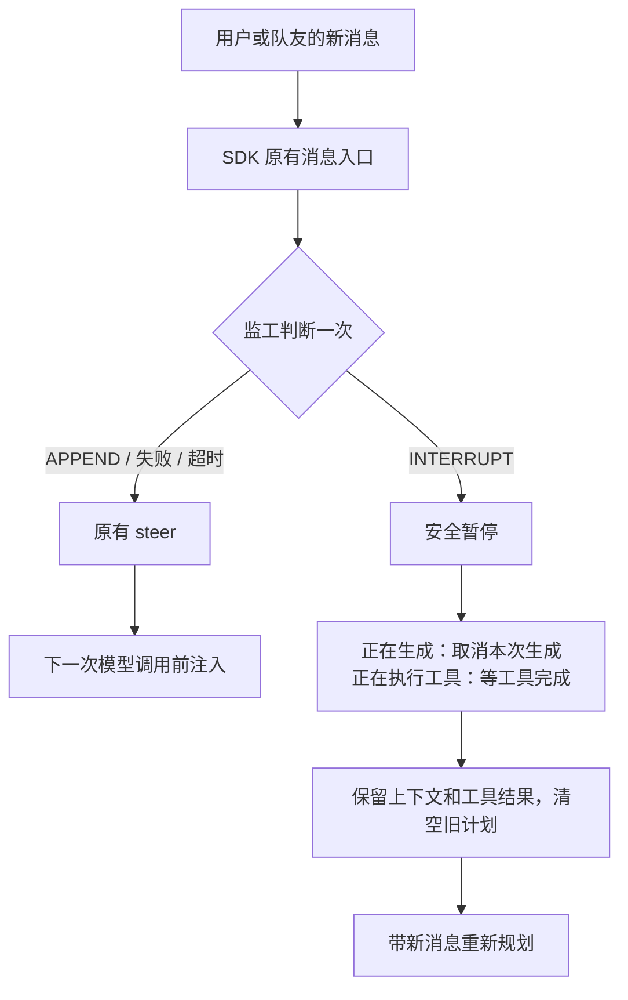

# 大小脑全双工：A2A 双工监工

执行 Agent 干活时，经常收到用户的新要求或队友的新发现。监工读新消息和当前任务，判断这条消息是追加（APPEND）还是必须打断（INTERRUPT）。追加时，行为和原来完全一样。打断时，执行 Agent 在安全的位置暂停，然后带着新消息重新规划。功能默认关闭。

> 例：执行 Agent 正在设计 Kafka 接入方案。队友确认"环境不能部署 Kafka，改用 Redis Streams"。监工判断为打断，Agent 尽早停下并重新规划。如果队友只说"Redis 连接信息在配置文件里"，监工判断为追加，Agent 不被打断。

## 名词

| 名词 | 含义 |
|---|---|
| 执行 Agent（大脑） | 执行任务的 Agent，负责规划、推理和调用工具 |
| 监工（小脑） | 快速分类模型。它不执行任务，只判断新消息怎么处理 |
| 全双工 | 监工判断和执行 Agent 同时运行。投递这条消息的调用本身仍然等监工返回结果 |
| U2A / A2A | 用户发给 Agent 的消息 / Agent 发给 Agent 的消息 |
| steer（插话） | SDK 原有的投递方式。当前这次模型调用继续，下一次模型调用时注入新消息 |
| followup（排队） | SDK 原有的投递方式。当前这一轮结束后，新消息作为独立的下一轮执行 |

## 消息怎么走



- 每条新消息只判断一次。U2A 和 A2A 用同一套机制。
- 监工失败、超时或返回非法结果时，消息照常走 steer，不重试。
- 打断不撤销已经发生的外部操作。已经开始的工具会执行完，结果保留。
- 用户显式暂停或停止优先。内部打断不会把 Agent 重新拉起来。
- 打断失败时，消息不退回 steer：A2A 消息保持未读，下次轮询重新投递；用户输入会向前端发送一条错误通知，提示重新发送。

### SDK 原有的 steer

`TeamAgent.deliver_input(content, use_steer=True)` 调用 `harness.send(content, immediate=True)`。结果取决于目标 Agent 当时的状态：

| 目标状态 | steer | followup |
|---|---|---|
| IDLE | 开一轮新的 | 同左 |
| RUNNING | 放入 steering 队列，下一次模型调用前注入，在同一轮里生效 | 放入 follow-up 队列，本轮结束后开新一轮 |
| PAUSED | 恢复暂停的那一轮，并把消息 steer 进去 | 同左 |
| TERMINATED | 报错 | 报错 |

APPEND 直接走这条路径，不额外调用模型。INTERRUPT 先安全暂停，再把"计划作废，请重新规划"和新消息一起作为 steer 送入。

## 哪些消息经过监工

| 场景 | 方向 | 双工关闭（SDK 原有行为） | 双工开启 |
|---|---|---|---|
| 用户文本 | U2A | steer | 经过监工 |
| 用户语音（task ASR） | U2A | 前端先转成文字，之后同用户文本 | 经过监工 |
| 实时语音 / 视频（`video_duplex` 扩展） | U2A | 走扩展自己的通路 | 不经过监工 |
| 队友私信 | A2A | steer | 经过监工 |
| 群聊 @ 某个 Agent | A2A / U2A | 只有被 @ 的成员收到，SDK 附带最近几条上下文，steer | 按私信处理，经过监工 |
| 群聊没有 @ | A2A / U2A | 只写入历史，不唤醒 | 同左 |
| 团队广播 | A2A | 除发送者外的所有成员收到，steer | 经过监工 |
| 系统提醒（看板巡视、催办、checkpoint） | 系统 | followup | 不经过监工 |
| 图片、文件、模板消息、人类成员的消息 | — | steer | 不经过监工 |

群聊 @ 消息交给监工判断时，只用这条消息本身，不带 SDK 附加的旧群聊记录。执行 Agent 收到的文本和原来一样。

## 配置

在"设置 → 智能体 → A2A 双工监工"中选择模式与后端。设置页显示当前监工摘要。点击编辑修改模型、地址和密钥；后端、超时和厂商参数在"高级设置"里。清除配置会关闭监工并清除共享密钥。修改模式后要重启团队。

```yaml
duplex_router:
  mode: active
  backend: sdk
  model_name: fast-model
  timeout_seconds: 2.0
```

| 后端 | 模型与接口 |
| --- | --- |
| `sdk` | `model_name` 为当前团队模型池中的名称，沿用 SDK 模型配置 |
| `jev` | 默认 `jev-1.13.0`；支持 `systemone` / `decisions`；概率达到阈值才打断 |
| `mindshub` | 默认 `mindshub_air`；使用 chat completions，返回 APPEND / INTERRUPT |
| `clef` | 选择 `clef` / `clef-flash`；使用 Cloudflare Workers AI；需要账号 ID 和 Token |

- 外部接口使用 `DUPLEX_ROUTER_API_KEY`，Clef 账号使用 `CLOUDFLARE_ACCOUNT_ID`。设置页沿用现有的密钥保存流程。
- 各后端的地址保存在 `duplex_router.<backend>.api_base`。先切换后端，再修改地址。
- JEV / Clef 的 `interrupt_threshold` 默认 0.9，取值大于 0.5 且不超过 1。MindsHub 不使用概率阈值。
- `timeout_seconds` 限制一次判断的等待时间。

## 独立分类包

`packages/choice-classifier` 是可以单独安装的分类包，只负责分类，不决定投递动作。每个问题返回 `choice`、`probabilities` 和 `confidence`。JEV 这类服务用 `TypedChoiceProvider`；支持 logprobs 的 OpenAI 兼容模型用 `LogprobLLMProvider`。详见 [包说明](../packages/choice-classifier/README.md)。

## Leader 全局停工

用户要求全员停止时，Leader 广播暂停请求，逐个核对成员是否已经停下。用户明确说恢复后，Leader 才重新组织执行。广播成功不等于执行已经停止，Leader 要区分已发送、部分确认和全员确认。这条规则写在 Leader 的提示词里，不是后端强制停机。

## 实现与验证

- `duplex_shadow.py`：安装入口。包装 SDK 的消息渲染（含群聊）、`TeamAgent.deliver_input` 和用户输入，只处理当前消息，不运行后台任务。
- `duplex_native.py`：对接 SDK supervisor 的暂停和恢复。
- `common/duplex_router.py`：限时调用监工并检查结果。各厂商模块负责请求协议。
- 接入使用 SDK 私有 hooks，已在 SDK 0.1.19 上核对。升级 SDK 时需要重新验证。签名变化时，`install_shadow_observer` 自动关闭双工，只记一条警告，消息照常投递。

```bash
python -m pytest --no-cov -q tests/unit_tests/common/test_duplex_choice.py tests/unit_tests/common/test_duplex_jev.py tests/unit_tests/common/test_duplex_mindshub.py tests/unit_tests/common/test_duplex_settings.py tests/unit_tests/agentserver/test_duplex_shadow.py tests/unit_tests/agentserver/test_team_leader_stop_prompt.py tests/integration_tests/test_duplex_e2e.py
```

测试覆盖请求协议、阈值、错误降级、设置保存，以及真实 SDK + SQLite + 本地 HTTP 下的打断、上下文和工具结果保留、去重、生命周期、已读确认和群聊 @。测试不依赖外部数据集。
