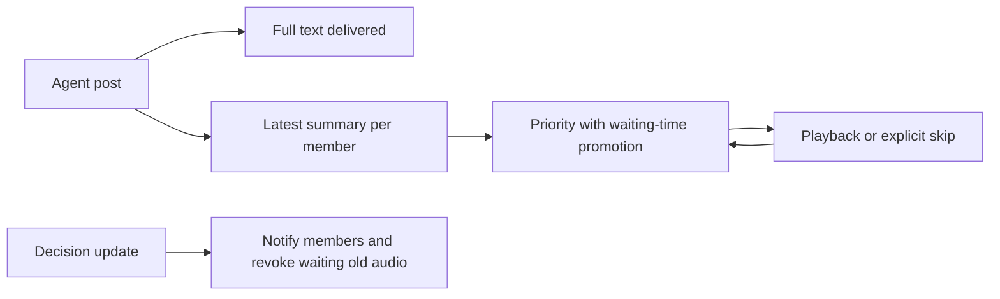

# Team meeting startup and voice

## Responsive host policy

The application uses `ResponsiveMeetingCoordinator`; the SDK itself is unchanged.
Full text is published immediately, while spoken summaries wait for a lease.
Chinese summaries are limited to 150 characters, English to 65 words (600
characters maximum). Overlong summaries return a tool error for rewriting; they
are never silently truncated. Each member has at most one waiting summary: a
new post replaces that member's waiting audio and preserves all published text.
After 60 seconds, waiting requests take priority over fresh Leader requests.

The Leader calls `meeting_update_context(summary)` for a substantive project or
decision change. It delivers a text-only decision update to all native members,
replaces their shared context, and cancels waiting old audio. The current speech
and published history remain intact. An in-flight post from an older context is
rejected so the member can revise it on the next model call. The system prompt
section carries this context because the native runtime rebuilds its message
window after model hooks. Context lives for this meeting; restart starts a new scope.

The panel shows the shared decision, pending summaries, and text delivery state.
Remove audio cancels only a waiting request. Skip current speech drains synthesis,
records a skipped receipt, and advances without muting input. Queue controls
require the owning browser connection. Explicit floor-taking commands such as
All confirmed human speech yields the audio floor without a semantic classifier;
other utterances still use its configured provider and conservative fallback.



Enable **Team meetings** under **Settings → Experimental**. The switch persists as
`experimental.team_meeting_enabled` in the existing configuration system and
updates the Task controls immediately. The feature is off by default.

For Feishu, save the App ID and App Secret under **Settings → Experimental →
Team meetings → Feishu settings**, then click **Connect**. The Gateway reuses the
existing Feishu channel for incoming messages and replies. **Connected** means
the SDK has established its WebSocket; failures and timeouts are shown inline.
Use **Disconnect** before changing or clearing credentials. This connection is
runtime-only: after a backend restart, click Connect again. An app already
running under **Settings → Channels → Feishu** must be managed there.
Feishu voice-note routing into Team meetings and synthesized voice replies are
not wired by this connection control.

**Meeting input routing** offers **Leader** (default) and **None**. The choice is
saved in this browser and captured when the next meeting starts. Voice transcripts
mention only the Leader or have no mentions, respectively. Startup remains an
unmentioned message. This selector leaves SDK delivery and evaluation unchanged;
under the current SDK, unmentioned group messages are retained as context.

With Leader routing, the Leader uses the existing `send_message` tool to relay
complete user messages verbatim to their intended agents. It must not summarize,
paraphrase, omit details, or append its own instructions. All other communication,
including the Leader's own delegation, coordination, follow-ups, questions and
reports, must use `meeting_post_message`. There is no separate forwarding
tool. The Leader first selects those agents with
`meeting_set_addressed_members(member_names)`, then uses `send_message(to, content)`
(or its existing `targets` form) to pass on the request without speech. Silent
sends are limited to the selected agents; user replies, broadcasts, and ordinary
discussion still go through `meeting_post_message` and the speaking queue.

The priority list is controlled explicitly by the Leader: replace it when focus
changes and clear it with `[]` when the exchange ends, is abandoned, or discussion
becomes general. Sending and playback do not reset it or interrupt the current
speaker. The target follows meeting guidance to reply to both user and Leader so priority
can be cleared silently. No spoken handoff, delivery acknowledgement, or redundant
summary is needed. Clarification, routing failure, or a substantive issue may
require intervention. Recipient selection uses the evolving roster; automatic
name matching and supervisor inference are separate work. Startup already builds
the Team, so `build_team` is hidden and blocked during coordinated publication.

When the roster is missing or unclear, the Leader can call the SDK's
`list_members` once, reuse existing members, and create only requested missing
AI participants with `spawn_teammate`. Clarification questions use
`meeting_post_message` with `mentions=["user"]` and a spoken question, then wait
for the human's answer. Teammates also mention the Leader so the answer can be
relayed back. A separate user agent is not required.

**JEV routing for teammates** is a separate Experimental switch for the default
Team. It sets `modes.team.jiuwen_team.duplex` to agent-core's native JEV router
(`enabled: true`, `mode: active`, `format: jev`). Existing Team endpoint, model,
key-environment and timeout settings are retained; absent settings use the SDK's
TypeSafe defaults and `TYPESAFE_API_KEY`. Start a new Team conversation to use
the setting. It evaluates teammate broadcasts and busy-member delivery, and does
not enable relevance evaluation of meeting user speech. Browser JEV settings are
independent. No live JEV request is made when saving the switch.

In **Tasks**, a compact meeting icon appears beside the voice controls in Team
conversations and on `/chat/new`. One click switches a new Agent task to Cluster
(Team) mode and creates the conversation. Start sends a visible **Start meeting**
group-chat message with no mentions, using the existing chat sender and selected
model/project/equipment. It prepares the Team without asking an Agent to reply.
The browser waits for that message's SDK acceptance and the meeting coordinator
before requesting microphone access. Initialization retries within the same
startup flow reuse the message identity. The text editor, Send button, and Enter
submission stay disabled until the existing startup and playback-ready handshake
finish. The microphone starts transmitting only after that handshake.

The microphone uses the same `JoyAIVoiceSession` as JoyAI full duplex. Browser
Silero VAD segments speech and sends completed WAV utterances to Gateway, which
transcribes them through the full-duplex ASR adapter
and sends each transcript through normal structured group-chat delivery. There
is no editor review or manual Send step. Listening continues during transcription
and agent playback. Pause microphone flushes a confirmed current utterance and
stops sending microphone samples; Resume microphone starts listening again.
These controls do not interrupt agent speech or acquire/hold its speaking lease.
Stop audio and End meeting remain separate controls. Leaving the conversation or
turning the feature off releases the microphone and clears playback.

Server lifecycle: meeting controls attach to the existing group-chat Team after
its initialization message is accepted. Duplicate controls reuse the reservation.
Conversation and coordinator initialization follow their SDK behavior. The
browser bounds waiting for message acceptance to 60 seconds and abandons that
wait on page teardown or disconnection; this adds no active-meeting polling.

Meeting input explicitly sets `meeting_mode` before the initialization message.
AgentServer selects `TeamAgentSpec.conversation_history_location="session"` for a
meeting-created runtime; its archive is under
`<team-home>/sessions/<session-id>/conversation/history.jsonl`. Ordinary group-chat
requests retain the SDK's existing shared-workspace layout. Reopening a meeting
archive remembers its location. Existing ordinary group-chat runtimes are not
silently converted; use a new meeting conversation. This requires an updated
agent-core SDK supporting the option; older SDKs fail with a specific update error.
File tools retain their current permissions, and the SDK still supplies scoped
message excerpts without granting broader filesystem access.

The dependency pin has not yet been updated. A new default Team starts with its
Leader; membership can grow through existing SDK tools. Existing ordinary Team
runtimes are not converted. Start a new conversation for a meeting in that case.
Ending a meeting leaves its group-chat runtime intact. This browser remembers
accepted group-chat conversations (including across tab reloads), so subsequent
typed input uses group-chat routing to the Leader as well.

End can cancel server preparation after conversation creation. `meeting.end`
requires the exact active meeting ID; an earlier startup uses `meeting.release`,
scoped to the connection owner and startup ID. The browser retains its shutdown
listener while cleanup is pending. Unconfirmed cleanup shows **Retry End meeting**
and prevents a replacement meeting until cleanup succeeds.

The manager retains lifecycle tasks independently of request cancellation. A
cancelled or abandoned initializer must finish unwinding before its coordinator
is cleaned up and the session becomes idle. During cleanup, new starts are
rejected. A cleanup error retains the coordinator as `cleanup_failed`; another
start retries that cleanup and asks the caller to retry afterward. Server shutdown
drains meetings before closing runtime resources. This protects the running
process; recovery after a process crash is not implemented here.

The browser checks meeting status while startup is pending. Once active, it uses
request errors and connection-state notifications without periodic meeting status
requests or automatic reconnection/resume.

After local media and listeners are ready, `meeting.playback.ready` prepares
server input and prepares one owner-specific TTS session on Gateway,
then activates publication/grant scheduling. The session is reused across speech
chunks and member voice changes. Every synthesis request supplies the exact text
and a model-qualified voice ID; no conversational history accumulates. Responses
use the general `gateway.voice.tts.TtsSession` interface. CosyVoice2 uses HTTP
and returns MP3; Qwen Omni uses its existing persistent WebSocket adapter,
verifies the generated transcript against the supplied text, and returns WAV.
CosyVoice2 does not supply an independently verified transcript. A failed or cancelled turn
discards its session without replay; Stop, End, release and disconnect drain active
requests before closing it.
AgentServer freezes each granted spoken summary, member voice, source message,
lease and playback identity. The browser calls `meeting.speech.synthesize` with
that identity and a chunk index; it cannot override text, model or voice. Gateway
resolves the canonical chunk on AgentServer, synthesizes it using the selected TTS provider,
then rechecks the lease/configuration before returning audio.
TTS requests run on Gateway. Configure **Settings > Experimental > Speech synthesis**:

```dotenv
TTS_PROVIDER=cosyvoice
TTS_API_BASE=https://api.siliconflow.cn/v1
TTS_API_KEY=your-siliconflow-key
TTS_MODEL_NAME=FunAudioLLM/CosyVoice2-0.5B
TTS_VOICE=FunAudioLLM/CosyVoice2-0.5B:anna

# To use Qwen, replace the values in the same five fields:
# TTS_PROVIDER=qwen_omni
# TTS_API_BASE=wss://your-workspace.example.com/api-ws/v1/realtime
# TTS_API_KEY=your-qwen-tts-key
# TTS_MODEL_NAME=qwen3.8-omni-flash-realtime
# TTS_VOICE=Tina
```

Choose CosyVoice2 or Qwen Omni in the provider selector and configure its URL,
key, model and default voice. Both providers read the same `TTS_API_BASE`,
`TTS_API_KEY`, `TTS_MODEL_NAME` and `TTS_VOICE` settings; the provider selects the
request protocol. Switching replaces these values together, with no additional
provider-specific configuration fields. CosyVoice2 accepts a base URL or full
`/audio/speech` endpoint; Qwen requires a WebSocket URL. The settings editor
pre-fills the saved TTS API key, masked by default with a visibility toggle. Missing or invalid
settings fail explicitly without falling back to another provider.
Restart the meeting after changing settings. Existing `QWEN_OMNI_*` configuration,
catalog and adapter remain available for other consumers. Meeting TTS never
inherits the normal Qwen/video credentials. Meeting input shares full-duplex provider selection and ASR configuration,
including the native JoyAI voice channel when configured. The separate task ASR
configuration is used only by legacy PCM clients.

Only natural playback completion of every chunk reports `meeting.playback.result`
as completed and releases the SDK speaking lease. Synthesized audio alone never
advances it as completed. A synthesis/playback error shows its failure, drains the
failed synthesis, and marks that speech interrupted before continuing to the next
queued item. Published full text remains available. The panel now uses Skip current speech,
which reports `skipped` and continues the queue. The legacy `stopped` receipt
still holds the queue for consumers that explicitly pause playback. Duplicate result receipts are idempotent,
including after the next grant. Foreign identities and stale leases are rejected.

End revokes synthesis, sends `meeting.playback.stop`, and waits for the browser's
`meeting.playback.stopped` receipt. The stop acknowledgement handler runs without
the driver lock; Gateway drains provider cancellation before forwarding the
receipt. Missing receipts retain `cleanup_failed` for an explicit End retry.
Disconnect never fabricates successful playback. Late audio cannot restart a
locally stopped player. Automatic chat-event narration is suppressed for the owned
session, and manual TTS shares an audio-stop signal with meeting playback.

Replies remain in the existing Task conversation. There is no standalone meeting
sidebar destination or second conversation editor. This path supports native
in-process Team members; process runtimes, Team plan mode and unsupported rosters
reject coordinated activation.

## Human and Leader interruption

Meeting capture reuses the video-duplex frontend `SileroVad`, its worker and
`SpeechGate`. Confirmed speech start immediately stops local TTS, including late
synthesis results, before any network request, ASR or semantic classification.
The same microphone retains echo cancellation and noise suppression. A
connection-owned `meeting.input.speech_started` request carries the observed
lease token; the server revokes only that lease and holds subsequent speech.
This does not pause execution tasks or close the microphone. Even a spoken
acknowledgement yields the audio floor once VAD confirms it.

ASR text still follows normal group-chat delivery. Nonempty transcripts attach
the existing interruption ID and release it only after public-message acceptance.
Empty/failed ASR releases a VAD-only hold without fabricating user text. A paused
microphone resets local VAD, and resumed listening starts with fresh evidence.
Older clients without a VAD start event yield the floor on a nonempty ASR
transcript. Neither path uses a semantic classifier or an extra model request.

The Leader can inspect `meeting_get_speaker` and call
`meeting_interrupt_speech(expected_token)` with its observed lease token. Only
the Leader receives this tool, and only while the host playback consumer is
installed. A stale token cannot cut a later speaker's speech. Interruptions stop
audio only; published full text and the remaining queued requests are preserved.

These paths revoke the matching SDK lease and send `meeting.speech.stop` with its
complete playback identity. The browser stops only that speech and keeps its
microphone active. Gateway drains synthesis cancellation before forwarding the
browser's `meeting.playback.stopped` acknowledgement. Cancelled TTS clients
are replaced before the next speaker. Late synthesis, duplicate speech events
and late completion receipts cannot replay or complete an interrupted speech.

The SDK interruption barrier blocks new grants until this stop is confirmed.
For human interruption it also waits for `meeting.input.admitted`, sent only
after the existing `team.group_message.accepted` event confirms public input
delivery. Duplicate admission receipts are idempotent. Failed delivery or a
missing audio stop acknowledgement keeps the barrier held; End meeting remains
the recovery action. Explicit Stop audio and audio failures retain their
existing paused/failed behavior and are distinct from human floor-taking.

Automated regressions cover the real SDK/SQLite queue, Gateway routes, native
Leader tool and browser player using controlled audio services. Physical
microphone/speaker behavior still requires a live meeting acceptance run.

## Continuous microphone input

This replaces the browser MediaRecorder/completed-recording strategy. Browser
VAD now handles immediate barge-in; Gateway VAD retains utterance segmentation.
There is no recorded-file upload or fallback to that old capture path in meetings.
The separate video-duplex feature retains its own provider-specific paths.

The browser reuses the capture worklet and resampler to send 100 ms chunks of
mono PCM16LE at 16 kHz. The existing `meeting.playback.ready` handshake validates
ownership, loads Gateway's bundled Silero v5 model, and returns a `stream_id`
before activating publication. Input shares that route's lifecycle; there is no
separate input startup or ownership registry.

`meeting.playback.ready` selects `input_mode: joyai` for current browsers.
`meeting.input.utterance` sends complete WAV data URLs with stream identity and
sequence. Capture, one-second pre-roll, Silero speech detection and the 20-second
turn limit reuse `JoyAIVoiceSession`. Pausing flushes confirmed speech, then resets
local detection; resuming keeps the same stream and sequence.

Gateway uses the same `transcribe_audio` adapter, provider selection and filler
filter as full-duplex `video.transcribe`. Three ASR workers preserve utterance
order, with up to seven outstanding utterances and a 60-second timeout. Each
ready result is published immediately in order; there is no short-sentence batch
or 1.5-second merge delay. Empty results do not fabricate user text. Admission
and interruption acknowledgements remain owned by the meeting lifecycle.
Stop, End and disconnect cancel pending ASR and suppress late results.

Legacy clients without an input mode retain the PCM upload, server Silero and
batching path for compatibility. Current browsers do not instantiate server VAD.

Deferred work includes semantic turn completion, supervisor recipient selection,
voice selection UI,
a recorded full meeting demonstration, and recovery after process restart.

Agent-side publication uses the host-consumer readiness gate. The shared native
member provider installs scoped meeting guidance and the
SDK's `meeting_post_message`, `meeting_read_history`, and `meeting_get_speaker`
tools for the Leader and later members, plus the Leader-only addressed-member
and `meeting_interrupt_speech` tools. The Leader retains the existing `send_message` for silent addressed handoffs.
Work and code profiles use the same
provider. Native discussion uses the host publication tool: text is delivered
immediately and speech is queued; unsupported direct-delivery/runtime tools are blocked while this scope is active. Ending the
scope removes the tools and prompt. No SDK or dependency change is required.
Meeting tool schemas stay directly exposed on every model request, including
when progressive tool discovery is enabled. Members use the supplied message
excerpts and roster first; startup does not require browsing `prompts/tool/`,
workspace metadata, or history files. Additional history is read only to fill
specific missing context needed by the user's request.

The host grant driver is implemented with a controlled consumer boundary. Queue
admission wakes SDK grant scheduling; matching owner playback completion releases
the lease as completed. An owner-confirmed audio failure revokes that speech as
interrupted and advances after synthesis has drained. Publication retry preserves
the original token and message identity. Delivery failures and explicit audio
stops hold the turn. Meeting cleanup
drains the worker and confirms consumer stop before closing the SDK coordinator.

Publication and grant scheduling accept an optional
`MemberVoiceRegistry` from `jiuwenswarm.common.voice_matching`. The host supplies
the exact configured TTS model and a registry scoped to the native Team/session; no
Gateway credentials are read by the meeting runtime. Existing roster bindings
are initialized with the Leader first. The common member rail attaches an
immutable `VoiceAssignment` for later native members and refreshes existing
members before their next model call.

Matching uses explicit preference, then an unused compatible voice, then the
least-used voice with catalog order breaking ties. CosyVoice2 uses eight preset
voices (Anna, Bella, Claire, Diana, Alex, Benjamin, Charles and David) from the
[SiliconFlow catalog](https://docs.siliconflow.cn/docs/userguide/capabilities/text-to-speech).
The Leader uses `TTS_VOICE`; members
receive distinct voices until the catalog is exhausted, then share the least-used
voice. Both providers use catalog files in `resources/voices/`.
Reuse the same registry for the same native runtime and model to retain assignments across meetings;
create a new one when that runtime is replaced. Catalog updates affect future
assignments while retained bindings keep queued speech reproducible.
The playback consumer resolves `voices.get_voice(request.member_name)` and
supplies its `provider_voice_id` to the Gateway TTS component. Lookup does not release the speaking
lease or start audio. Browser readiness now creates/reuses this registry for the
same native runtime; process-restart restoration remains deferred.

Validation (from `jiuwenswarm/channels/web/frontend`):

```sh
npm run test:meeting
npm run test:i18n-locales
npm run test:task-full-duplex
npm run build
```

Backend lifecycle validation (from the repository root, using the project
Python environment):

```sh
python -m pytest tests/unit_tests/agentserver/test_meeting_browser_playback.py tests/unit_tests/agentserver/test_meeting_manager.py tests/unit_tests/agentserver/test_team_helpers.py tests/unit_tests/common/test_team_meeting_config.py tests/unit_tests/gateway/test_app_web_handlers.py -o addopts='' -q --asyncio-mode=auto
```

Set `JIUWENSWARM_DATA_DIR` to a temporary directory to isolate application logs
and data. On Windows, use a normal shell if sandbox restrictions stall asyncio.

Input validation covers segmentation, continuous capture, ordered ASR, and
cancellation:

```sh
python -m pytest tests/unit_tests/agentserver/test_meeting_input_audio.py -o addopts='' -q --asyncio-mode=auto
```

The automated input tests use synthetic audio and controlled ASR responses;
physical microphone/speaker echo cancellation and live provider accuracy still
need a browser meeting run.

Live provider synthesis and complete browser playback are checked manually;
the retained automated tests use controlled provider responses.


### Meeting action execution

`meeting_action` is a meeting-scoped ledger, separate from SDK task state. It does not change dispatch mode, verification configuration, task tools or task tables. The Leader assigns an owner, a distinct reviewer and concrete acceptance criteria. Owners execute with existing tools and submit evidence; only the reviewer can accept. Rework reopens accepted work; blocked work retains its original goal and unblock condition. Revision checks reject stale updates. `finish` rejects unfinished work and distinguishes waiting for external dependencies from completion.

Action notifications use existing meeting message delivery without waiting for TTS. Start/status updates do not wake teammates. Routine progress does not invalidate speech context. The panel displays action state, acceptance, evidence and review/block notes. Review quality still depends on the reviewer actually inspecting artifacts; the ledger cannot prove arbitrary external work is correct. The ledger lasts for the active meeting instance; it is not a replacement for durable cluster tasks.


### Listener-oriented speech

Spoken summaries describe the concrete work, its actual result/uncertainty and the next action in everyday language (normally 50–100 Chinese characters, with the existing 150-character/65-word hard limit). Task/revision IDs, hashes, code/tool names, file paths and URLs stay in full text. Publication rejects these technical forms before storing/notifying/queuing a post and asks the originating agent to rewrite only speech_text. There is no additional summary-model request and no destructive identifier stripping. Product names, useful counts and clock times are allowed. Prompts distinguish specifications from implementation and submission from independent acceptance; the validator checks form, not the truth of arbitrary claims.


### Stop invalid work before investigating a scope change

On an explicit user change that invalidates existing actions, the Leader must first call `meeting_action(operation="pause", action_ids=[...], note="...")`, before browsing or analysing the replacement project. This meeting-only batch operation needs no per-action revisions. It retains artifacts, marks affected actions paused, invalidates affected members' in-flight tool generations, cancels their waiting audio and attempts to interrupt their current speech. Notification/audio failures do not undo the execution gate. Paused actions cannot start, submit or accept; the Leader must cancel or rework them after investigation. Members whose owned work is paused cannot execute further side-effect tools; read-only inspection remains available. Unrelated actions continue. Ordinary questions do not call pause. Commands already running can finish and require reassessment; this does not roll back external effects or alter SDK/cluster task tools. Action state lasts for the current meeting instance.
